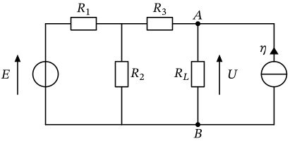
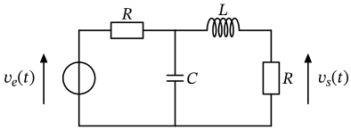
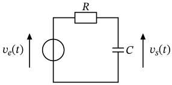
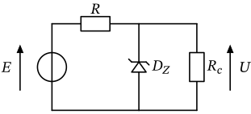
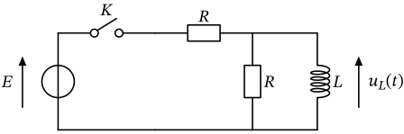
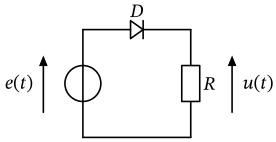

# fil-rouge

Electric circuit diagrams as SVG files, drawn the way French textbooks and exams draw them.
A thin layer over [schemdraw](https://schemdraw.readthedocs.io) with LaTeX labels.

<p>


</p>

Most circuit libraries follow US or IEEE symbols. A French student expects other ones:

| Element | fil-rouge | Usual library default |
|---|---|---|
| Voltage source | circle crossed by the wire (`SrcU`) | circle with + and − |
| Current source | circle crossed across the wire (`SrcI`) | circle with an arrow inside |
| Resistor | rectangle (IEC) | zigzag |
| Voltage | arrow beside the dipole (`tension`) | + and − signs |

Labels are LaTeX (`$R_1$`, `$v_e(t)$`, `$\underline{Z}_{th}$`). They are written into the SVG as outlines,
so a phone without math fonts shows the same drawing.

Made for [EPITA Doomscrolling](https://epitadoomscrolling.pierref.eu), an exam training site for EPITA prépa
students, where it draws 213 electronics exercises. By [Morgan Pierrefeu](https://morgan.pierref.eu).

## Install

```bash
pip install git+https://github.com/evaspace/fil-rouge
```

It pulls `schemdraw` and `ziamath`. Python 3.9 or newer.

## Ladder circuits in one line

Filters, RC/RL circuits and most diode circuits are ladders: a source, then elements in series on the top
wire and elements in parallel down to the bottom wire. `echelle` (French for ladder) draws them from a list.

```python
from filrouge import draw, echelle

svg = draw(lambda d: echelle(d, "v_e(t)", [("s", "R", "R"), ("p", "C", "C")], "v_s(t)"))
open("rc.svg", "w").write(svg)
```



Each branch is `("s", code, label)` for series or `("p", code, label)` for parallel.

| Code | Element |
|---|---|
| `R` | resistor |
| `C` | capacitor |
| `L` | coil |
| `D`, `DZ` | diode, Zener diode (anode on the first end); `D<`, `DZ<` the other way |
| `K` | switch |
| `U`, `I` | voltage source, current source |
| `Z` | generic impedance |

The last argument labels the output voltage. Without it, a circuit that ends with a series element is closed
by a wire.

<p>



</p>

## Any other circuit

Place each element by its two ends with schemdraw's `endpoints`, then add arrows:

```python
from filrouge import R, Fil, Point, SrcI, SrcU, courant, draw, tension

def circuit(d):
    d += (s := SrcU().endpoints((0, 0), (0, 4)))
    tension(d, s, "$E$")                      # voltage arrow beside the source
    d += R().endpoints((0, 4), (3, 4)).label("$R_1$")
    d += R().endpoints((3, 4), (3, 0)).label("$R_2$", loc="bottom")
    d += Point().at((3, 4)).label("$A$", loc="top")
    d += (s := SrcI().endpoints((6, 0), (6, 4)))
    courant(d, s, "$\\eta$", debut=False)     # current arrow head on the wire
    d += Fil().endpoints((3, 4), (6, 4))
    d += Fil().endpoints((0, 0), (6, 0))

open("circuit.svg", "w").write(draw(circuit))
```

`examples/gallery.py` draws every picture of this page.

## API

| Name | What it does |
|---|---|
| `draw(fn, fontsize=19, lw=1.6)` | runs `fn(d)` on a new drawing, returns the SVG text |
| `save(fn, folder, prefix="circuit-")` | writes `folder/<prefix><hash>.svg`; the same drawing keeps the same name, so pages can cache it |
| `echelle(d, source, branches, sortie=None, sortie_sur=None)` | ladder circuit, see above |
| `tension(d, e, label, sens=1, cote=True)` | voltage arrow beside element `e`; `sens=-1` reverses it, `cote` picks the side |
| `courant(d, e, label, sens=1, debut=True, loc=None)` | current arrow head on the wire of `e`, at its start or end |
| `SrcU`, `SrcI` | French voltage and current sources |
| `R`, `C`, `L`, `D`, `DZ`, `Fil`, `Point`, `Masse`, `Inter`, `Gap` | IEC resistor, capacitor, coil, diode, Zener, wire, node, ground, switch, invisible gap |

Gotcha: schemdraw's `.reverse()` is ignored once `.endpoints()` places an element. Swap the two ends instead
(`echelle` does it for codes ending with `<`).

## Use on a web page

The SVG has no external font and no script, so an `` tag is enough. With Markdown:
``. Keep the circuit
in words in the `alt` text: screen readers and "copy for an AI" buttons only see that.

## Tests

```bash
python -m unittest tests/test_filrouge.py
```

## License

MIT
